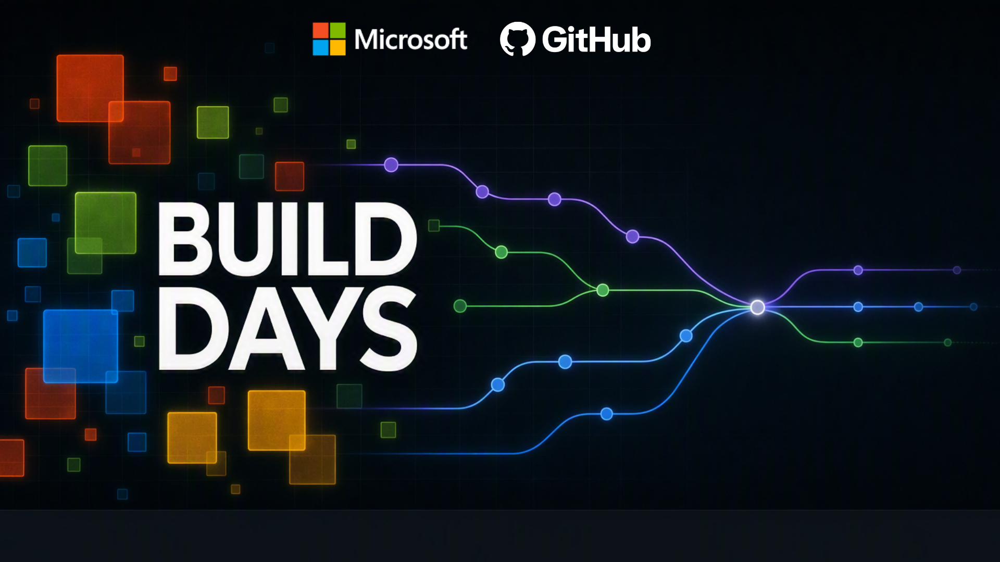

# Government of Saskatchewan Build Day

## Modern app development with GitHub Copilot

**Audience:** Government of Saskatchewan developers and local partners

**Level:** Beginner to intermediate, with an optional advanced capstone

```text
      [ o.o ]
       /|=|\
      /_| |_\
        / \
     BUILD DAY
```

## 🌟Why do the Day 1 labs?

These labs set you up for the rest of Build Days. By the end of Day 1 you will:

1. **Be ready for Day 2.** The Day 2 activities build on the repository,
   tools, and habits you set up here.
2. **Know what AI native engineering with GitHub looks like.** You plan with
   Copilot, write a spec, and let agents do bounded work that you review.
3. **Run work without typing every step yourself.** Instructions, agents,
   skills, and workflows carry the work while you steer and review.
4. **Try multi-agent orchestration in the GitHub Copilot app.** You run
   sessions and agents side by side and decide what each one may do.
5. **Learn application modernization (AppMod).** Use Copilot, Modernize CLI,
   and the Upgrade agent to move a legacy Java or .NET app to modern
   frameworks and runtimes. Understand its business logic first, then upgrade
   in small steps and test that the behavior still works.
6. **Automate with GitHub Agentic Workflows.** You compile and inspect
   workflows that turn a spec into issues, issues into draft pull requests,
   and pull requests into QA reviews.
7. **Build in a way that works for you.** Pick Java or .NET, pick a capstone
   pathway, and shape your instructions and agents around how your team works.
8. **Have fun!** This is a build day. Try things, break things in your fork,
   and ask the coaches for help.

## 🛠️ What you will do

You work in one repository with the GitHub Copilot app. You start by checking
your setup, write and approve a spec in Plan mode, then modernize an app,
add guarded agentic workflows and automated QA, and finish with a capstone.

Java and .NET are equal tracks. Pick one during readiness and stay with it for
the modernization work. You do not need to finish both.

## 🚀 Get started

1. Fork or clone this repository once.
2. Run commands from the repository root unless a lab tells you to change
   folders.
3. Do [Lab 00: Readiness](labs/00-readiness/) before the event. If the
   readiness script fails, bring the first failing check with you.
4. Follow the labs in order:

   | Lab | What you do |
   | --- | --- |
   | [00 Readiness](labs/00-readiness/) | Check your tools and pick a track |
   | [01 Plan mode and a spec](labs/01-spec-driven-development/) | Write and approve one bounded spec |
   | [02 Copilot instructions](labs/02-copilot-instructions/) | See which guidance Copilot uses and improve it |
   | [03 Custom agents and skills](labs/03-custom-agents-and-skills/) | Build a small agent and use a skill |
   | [04 App modernization](labs/04-app-modernization/) | Modernize [Java](labs/04-app-modernization/java/) or [.NET](labs/04-app-modernization/dotnet/) |
   | [05 Agentic SDLC with `gh-aw`](labs/05-agentic-workflows/) | Compile and inspect guarded workflows |
   | [06 CI and agentic QA](labs/06-automated-qa/) | Keep CI in charge and add advisory QA |
   | [07 Capstone](labs/07-capstone/) | Build and demo a small, tested slice |

The [lab index](labs/) has more detail on each lab.

Everything lives in this one repository: the imported apps, labs, specs,
Copilot customizations, automation, capstone starters, and facilitator notes.
That keeps links and validation commands working from a single checkout.

## Open the interactive lab guide

[**Open the lab guide in GitHub Copilot**](https://github.com/copilot/app/launch?open=ghapp%3A%2F%2Fsession%2Fnew%3Frepo%3DVeVarunSharma%252Fgov-of-sask-build-days-appmod-to-agentic-sdlc%26mode%3Dinteractive%26prompt%3DOpen%2520the%2520Build%2520Day%2520lab%2520guide%2520canvas.%2520Do%2520not%2520run%2520any%2520lab%2520commands.)

Requires a canvas-capable GitHub Copilot app. The link prepares a new interactive
session for this repository with the opening prompt filled in. Review and
submit the prompt to open the canvas; it does not run lab commands.

The guide is included in this repository at
[`.github/extensions/lab-journey/`](.github/extensions/lab-journey/README.md).
Fork or clone the complete repository, open it in the app, and start a new
session. The project extension is discovered without a separate SDK package
installation. It provides animated steps, Java/.NET track selection, copy
buttons, and private progress saved on your machine.

Already in a session, or using your own fork? Ask:

```text
Open the Build Day lab guide canvas. Do not run any lab commands.
```

[Setup and project-install instructions](.github/extensions/lab-journey/README.md#install-the-guide)
include the manual install route and troubleshooting. The
[Markdown labs](labs/README.md) remain available without the canvas.

## 🤖 How Copilot picks up guidance

Copilot reads several kinds of guidance in this repository: the repository-wide
instructions, path-specific instructions, and the root and folder-level
`AGENTS.md` files. They work together. Collect the guidance that applies to the
file you are changing, and if two sources disagree, stop and sort it out. Do not
assume one always wins. [Lab 02](labs/02-copilot-instructions/) walks through
this, so you do not need to memorize it during setup.

## 🧭 Choose an application track

| Track | Starting source | Platform | Modernization target |
| --- | --- | --- | --- |
| Java Asset Manager | [`legacy-src/java-asset-manager`](legacy-src/java-asset-manager/) | Windows, macOS, or Linux; JDK 8 and JDK 21 | Java 21, Spring Boot 3, updated dependencies, containers, and an Azure-ready design |
| .NET BookCatalog | [`legacy-src/dotnet-bookcatalog`](legacy-src/dotnet-bookcatalog/) | Windows only: the classic ASP.NET MVC 5 baseline needs Visual Studio/MSBuild, .NET Framework 4.8, LocalDB, and .NET 10 | Modern ASP.NET Core/EF Core, containers, and an Azure-ready design |

The .NET app is BookCatalog, imported from
`microsoft/dotnet-modernization-for-beginners`. It is not ContosoUniversity.
Both imported apps are starting points, not generated checkpoints. Keep their
attribution and change only the track your team picked.

### Known Java baseline defect

The imported Java app has one known test error from upstream:
`S3FileProcessingServiceTest.downloadOriginalCopiesFileFromS3` tries to mock
the final AWS SDK `ResponseInputStream` class. On JDK 8, packaging with tests
skipped can succeed, but a full test run reports one error. Do not call that a
pass, and do not delete or disable the test to hide it. Use the
[known upstream test recovery card](facilitator/recovery/java/known-upstream-test.md).
The goal is a test suite that passes on JDK 21 and still checks real behavior.

## 🔧 Application modernization (AppMod)

The GitHub Blog article
[How GitHub Copilot and AI agents are saving legacy systems](https://github.blog/ai-and-ml/github-copilot/how-github-copilot-and-ai-agents-are-saving-legacy-systems/)
describes a three-step framework for AI-powered legacy modernization:

1. Code preparation (reverse engineering): understand the business logic and
   dependencies in the existing app.
2. Enrichment: give AI useful context through reviewed documentation and
   explanations of how the code works.
3. Automation aids: use specialized agents and workflows for repeatable work,
   with tests and human review.

The article uses COBOL examples. We apply these ideas to Java and .NET in
[Lab 04](labs/04-app-modernization/README.md#the-three-step-framework-in-this-workshop).

## 🧰 Modernization tools in the GitHub Copilot app

After Lab 01 gives you one approved spec, the modernization lab uses two tools:

- **Modernize CLI** (`modernize`) assesses the repository and drafts a
  technical plan. Install it before the event and check that
  `modernize --help` works.
- **Upgrade agent plugin** does the guided implementation in the GitHub
  Copilot app. Open **Settings > Plugins**, add the
  `microsoft/upgrade-agent-plugins` marketplace, approve it, and install
  `upgrade-agent`. Start a new session and use `/agent` to confirm
  `upgrade-agent:upgrade` is there, or pick **Upgrade** in the agent picker.

Treat the assessment and plan as proposals. Check them against your approved
spec, then review scope, architecture, security, cost, validation, and cleanup
before you let the Upgrade agent run. If a tool is not available, write down
the blocker and use the documented review and local validation route. Never
make up tool output.

## ⚙️ Agentic workflows and CI

The regular `ci-*.yml` GitHub Actions run fixed, repeatable commands. They
decide whether a change can merge.

The Markdown `gh-aw` workflows look at evidence and suggest small changes.
They post advisory reviews or open draft pull requests through safe outputs,
and do nothing when the evidence is weak. They never replace, approve, silence,
or weaken CI.

GitHub Agentic Workflows is in public preview. The checked-in lock files were
generated with `gh aw version v0.89.21`, and other releases may change the
schema or the generated YAML. Use that pinned version for the labs, never edit
`.lock.yml` files by hand, and treat a version upgrade as its own reviewed
change. Live runs that can write to GitHub are optional and only allowed in a
throwaway workshop fork with explicit approval.

For the optional [Modernize CI/CD route](scripts/modernization/README.md),
separate Java and .NET workflows produce weekly assessment reports after
setup. GH-AW proposes advisory work, and a maintainer can execute an exact
reviewed upgrade plan to produce a draft PR. Credentials and live runs require
separate setup; deterministic baseline/target CI still decides what can merge.

## 🗓️Event agenda

| Time | Session | You should have |
| --- | --- | --- |
| 10:00-10:10 | Welcome and safety | Success criteria and the no-production rule |
| 10:10-10:20 | The North Star | A view of the one-repository agentic SDLC flow |
| 10:20-10:35 | Modernization | Outcomes linked to engineering evidence |
| 10:35-10:50 | [Lab 00: readiness](labs/00-readiness/) and track choice | Fork or branch, Copilot app, chosen baseline, and any blockers written down |
| 10:50-11:10 | [Lab 01: Plan mode and spec](labs/01-spec-driven-development/) | One approved spec and no app code changes |
| 11:10-11:25 | [Lab 02: Copilot instructions](labs/02-copilot-instructions/) | A guidance trace with matching and non-matching evidence |
| 11:25-11:40 | [Lab 03: agents and skills](labs/03-custom-agents-and-skills/) | A bounded agent and a reusable skill |
| 11:40-12:00 | [Lab 04: Modernize assessment and plan](labs/04-app-modernization/) | A reviewed assessment and a plan that matches your spec |
| 12:00-12:30 | Lunch | No deployments or workflow runs left running unattended |
| 12:30-1:45 | Lab 04: Upgrade execution | A reviewed slice that passes locally |
| 1:45-2:05 | [Lab 05: agentic SDLC](labs/05-agentic-workflows/) | Compiled and inspected `gh-aw` sources and locks |
| 2:05-2:25 | [Lab 06: automated QA](labs/06-automated-qa/) | You can explain CI versus agentic review and fixes |
| 2:25-2:45 | [Lab 07: capstone](labs/07-capstone/) | A thin slice, validation evidence, and a demo script |
| 2:45-3:00 | Closeout | Evidence, limits, cleanup, and your next step |

The times are checkpoints. Running short on time is not a reason to skip
validation. If setup, policy, quota, or permissions block a cloud step or a
live workflow run, use the documented local path instead.

## 🎨 Capstone choices

Pick one pathway, or combine small, tested pieces of more than one:

1. [Go deeper on your modernization](labs/07-capstone/pathways/01-modernization-deep-dive.md).
2. [Build a public-service prototype](labs/07-capstone/pathways/02-public-service-app.md)
   with the React starter and either the Java or .NET API.
3. [Automate an engineering pain point](labs/07-capstone/pathways/03-agentic-workflow.md)
   with a guarded `gh-aw` workflow.

Use synthetic data. Stay away from high-stakes decisions such as eligibility,
enforcement, health, employment, licensing, or benefits. Azure deployment and
live `gh-aw` runs are optional. A tested local slice plus a reviewed deployment
plan, or compile and audit evidence, counts as done.

## ☁️ Azure: ownership, deployment, and cleanup

You can finish the workshop without Azure. If you do deploy, use an approved
non-production subscription that you own or control. You need to know its
budget, quota, role, region, exact resource group name, naming prefix, and
safety tag. Do not use a facilitator's subscription, a shared production
subscription, or a resource group nobody owns.

Run the [Azure preflight helper](scripts/azure/) before you create anything.
Review the what-if or plan output, and keep everything in one tagged resource
group. Cleanup is part of the exercise, even after a failed deployment: preview
the deletion, confirm the group name, run the cleanup, and record that
`az group exists` returns `false`.

If policy, quota, role, cost, or ownership stops you, that blocker plus full
local evidence is a valid result. Weakening security or claiming a deployment
you did not do is not.

## ✅ Prerequisites

Everyone needs:

- a GitHub account that can fork this repository or use an approved
  throwaway one
- GitHub Copilot Pro, Pro+, Business, or Enterprise
- the GitHub Copilot app, Git, and a signed-in GitHub CLI
- Modernize CLI and the `upgrade-agent` plugin
- the pinned `gh-aw` extension
- Docker Desktop or another container runtime
- Node.js and npm for the capstone starter

Install only the Java or .NET toolchain for your track. You need Azure CLI, a
signed-in Azure session, and a subscription you control only if you take the
optional Azure path. You do not need any extra spec tool or framework.

## Repository map

```text
legacy-src/                 # Imported Java and .NET starting applications
capstone-src/               # React plus Java/.NET greenfield starter
labs/                       # Participant flow, 00 through 07
specs/                      # Durable specification templates and examples
scripts/                    # Readiness, validation, and Azure helpers
facilitator/                # Runbook, recovery cards, and references
assets/                     # Images used by the documentation
.github/
  instructions/             # Path-scoped Copilot guidance
  agents/                   # Repository custom agents
  skills/                   # Reusable diagnostic/review skills
  workflows/                # Deterministic CI and gh-aw sources/locks
```

## Facilitator, validation, and maintenance

- [Facilitator index](facilitator/)
- [Single-room facilitator runbook](facilitator/guide/)
- [Recovery matrix](facilitator/recovery/)
- [Reference solutions](facilitator/reference-solutions/)
- [End-to-end validation report](facilitator/guide/VALIDATION.md)
- [Contributor and maintenance guide](CONTRIBUTING.md)

The validation report lists what was actually run, the known Java upstream
defect, and what was not checked, including live Azure deployment and live
workflows that write to GitHub. A static review is not proof that something
runs.

## License and attribution

Workshop material is licensed under the root [MIT License](LICENSE). The
imported Java and .NET snapshots keep their own license files. See
[Third-party notices](THIRD_PARTY_NOTICES.md) for attribution and
[`UPSTREAM_SOURCES.yml`](UPSTREAM_SOURCES.yml) for pinned source revisions,
import paths, and the unlicensed source that was left out on purpose.

Upstream references:

- [Agentic Modernization Workshop](https://github.com/Azure-Samples/Agentic-Modernization-Workshop)
- [Java migration samples](https://github.com/Azure-Samples/java-migration-copilot-samples)
- [.NET Modernization for Beginners](https://github.com/microsoft/dotnet-modernization-for-beginners)
- [Modernize CLI](https://github.com/microsoft/modernize-cli)
- [Upgrade agent plugin](https://github.com/microsoft/upgrade-agent-plugins/tree/main/plugins/upgrade-agent)
- [GitHub Agentic Workflows](https://github.github.com/gh-aw/)
